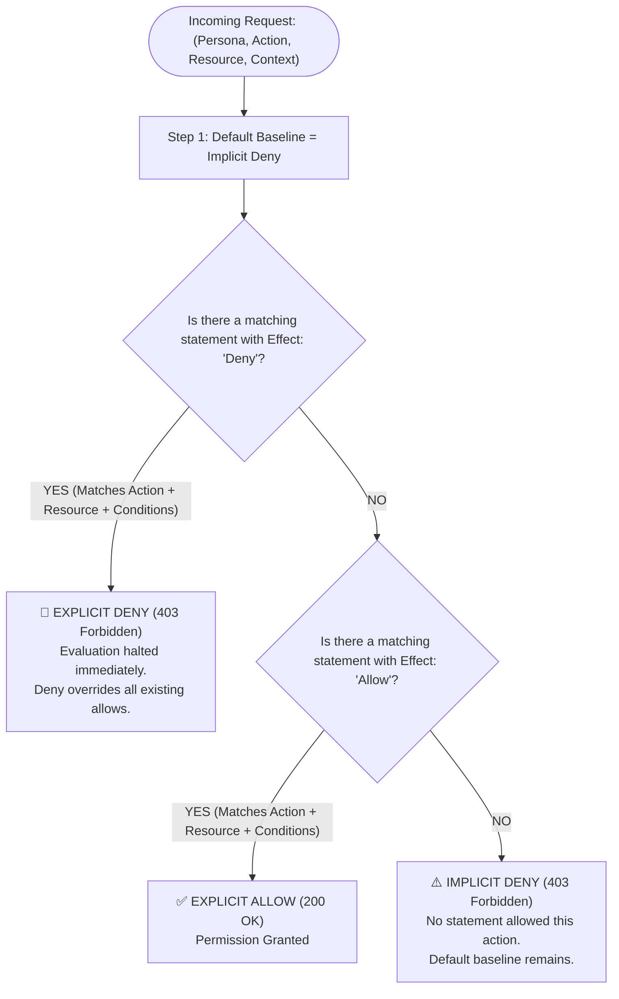

# Practical 07: Identity & Access Management (IAM) Least Privilege Simulator

[](https://www.docker.com/)
[](https://nginx.org/)
[](https://www.python.org/)
[](LICENSE)

An ultra-lightweight (< 35 MB RAM) **Cloud Identity & Access Management (IAM) Policy Evaluation Engine & Least Privilege Simulator** implementing AWS-standard JSON policy syntax, explicit deny precedence, wildcard action/ARN matching, and sub-millisecond decision tracing.

In modern cloud computing, identity is the primary security perimeter. This project demonstrates how cloud policy engines evaluate complex access control lists, enforce organization-wide guardrails, and mitigate privilege escalation risks without human intervention.

---

## 🏗️ The IAM Policy Evaluation Algorithm

Every authorization request submitted to the engine is evaluated through the formal AWS IAM deterministic pipeline:



---

## 📐 Core IAM Security Principles Implemented

### 1. The Principle of Least Privilege (PoLP)
Every identity (user, service account, or role) is provisioned with strictly the minimum set of permissions required to perform its intended job function:
* **Junior Developer:** Permitted read access to development S3 buckets (`arn:aws:s3:::dev-*`) and EC2 describe calls, but explicitly blocked from touching any production resource (`*prod*`).
* **DevOps Engineer:** Authorized to deploy and reboot compute resources across staging and production, but bounded by an explicit guardrail deny rule preventing database deletion (`rds:DeleteDBInstance`).
* **Database Administrator:** Administers database instances, but destructive drop commands strictly require **Multi-Factor Authentication (MFA)** via the `aws:MultiFactorAuthPresent` condition key.
* **Security Auditor:** Possesses organization-wide read-only visibility into audit trails (`cloudtrail:LookupEvents`) and IAM roles, with an explicit deny blocking all create, update, and delete mutations.

### 2. Explicit Deny Precedence
In standard IAM engines, an **Explicit Deny** statement always takes precedence over an **Explicit Allow**, regardless of the order of evaluation or statement specificity.

---

## ⚙️ Component Breakdown

| Component | Technology | Role & Function | Resource Usage |
| :--- | :--- | :--- | :---: |
| **Reverse Proxy & Host** | `nginx:1.27-alpine` | High-performance HTTP server hosting the simulation workbench and proxying API calls. | **~5.8 MiB** |
| **IAM Policy Engine** | Python 3.12 + Flask + Gunicorn | Deterministic rule parser, wildcard matcher, condition evaluator, and step-by-step decision tracer. | **~24.2 MiB** |
| **Interactive Workbench** | Vanilla HTML5 / CSS3 / ES6 | Live role switcher, MFA context toggle, 1-click action vector testing, and live decision pipeline visualizer. | Client Browser |

---

## 🚀 Quickstart & Setup

### 1. Prerequisites
* [Docker Desktop](https://www.docker.com/products/docker-desktop/) (macOS / Windows / Linux) with Docker Compose v2.

### 2. Configure Environment
```bash
cd practical-07-iam-access-control
cp .env.example .env
```

### 3. Launch Stack
```bash
docker compose up --build -d
```

### 4. Verify Active Containers
```bash
docker compose ps
```
You should see:
* `practical-07-iam-backend` (Up on port 5000)
* `practical-07-nginx` (Up on port 8080)

---

## 🖥️ Interactive Testing & Demonstration Protocol

Open your browser at **[http://localhost:8080](http://localhost:8080)**.

### Scenario A: Testing Junior Developer Boundaries
1. Select the **Junior Developer** tab on the top bar.
2. Click the green action: `s3:GetObject` on `arn:aws:s3:::dev-assets/config.json`:
   * **Result:** **`ACCESS GRANTED (200 OK)`** via Statement `AllowS3DevRead`.
3. Now click the red action: `s3:PutObject` on `arn:aws:s3:::prod-customer-vault/users.csv`:
   * **Result:** **`EXPLICIT DENY (403 FORBIDDEN)`**. Notice the trace reveals that Statement `ExplicitDenyProductionAccess` immediately halted evaluation because the resource matched `*prod*`.

### Scenario B: Testing DevOps Guardrail Against Database Destruction
1. Select the **DevOps Engineer** role.
2. Click `ec2:StartInstances` on production compute:
   * **Result:** **`ACCESS GRANTED (200 OK)`**.
3. Click `rds:DeleteDBInstance` on `prod-core-database`:
   * **Result:** **`EXPLICIT DENY (403 FORBIDDEN)`**.
   * *Security Insight:* Even though DevOps has broad `Allow` rules on compute and storage, the organization guardrail `GuardrailDenyProdDBDestruction` prevents accidental deletion of production databases.

### Scenario C: Testing MFA-Gated Conditional Access (DBA Role)
1. Select the **Database Administrator (DBA)** role.
2. Ensure the top **Simulate MFA Active** toggle is **OFF**.
3. Click `rds:DeleteDBInstance`:
   * **Result:** **`EXPLICIT DENY (403 FORBIDDEN)`** via Statement `RequireMFAForDatabaseDrop`.
4. Now toggle **Simulate MFA Active** to **ON**.
5. Click `rds:DeleteDBInstance` again:
   * **Result:** **`ACCESS GRANTED (200 OK)`**! The condition `aws:MultiFactorAuthPresent == true` was satisfied, bypassing the deny rule and permitting authorized execution.

---

## 🧪 CLI-Driven Validation

You can evaluate any permission matrix directly via terminal `curl`:

```bash
# 1. Test Junior Developer reading dev bucket (Expect 200 ALLOW)
curl -s -X POST http://localhost:8080/api/evaluate \
  -H "Content-Type: application/json" \
  -d '{"persona": "junior-developer", "action": "s3:GetObject", "resource": "arn:aws:s3:::dev-assets/logo.png"}' | python3 -m json.tool

# 2. Test Junior Developer attempting prod write (Expect 403 EXPLICIT_DENY)
curl -s -X POST http://localhost:8080/api/evaluate \
  -H "Content-Type: application/json" \
  -d '{"persona": "junior-developer", "action": "s3:PutObject", "resource": "arn:aws:s3:::prod-vault/key.pem"}' | python3 -m json.tool

# 3. Test DBA deleting database without MFA (Expect 403 EXPLICIT_DENY)
curl -s -X POST http://localhost:8080/api/evaluate \
  -H "Content-Type: application/json" \
  -d '{"persona": "database-admin", "action": "rds:DeleteDBInstance", "resource": "arn:aws:rds:us-east-1:123456789012:db:prod-db", "context": {"aws:MultiFactorAuthPresent": "false"}}' | python3 -m json.tool

# 4. Test DBA deleting database WITH MFA (Expect 200 ALLOW)
curl -s -X POST http://localhost:8080/api/evaluate \
  -H "Content-Type: application/json" \
  -d '{"persona": "database-admin", "action": "rds:DeleteDBInstance", "resource": "arn:aws:rds:us-east-1:123456789012:db:prod-db", "context": {"aws:MultiFactorAuthPresent": "true"}}' | python3 -m json.tool
```

---

## 📊 Measured Resource Consumption

Inspected via `docker stats --no-stream` under live operation:

| Container | Memory Usage | Memory % | CPU % |
| :--- | :---: | :---: | :---: |
| `practical-07-nginx` | **5.8 MiB** | 0.15% | 0.00% |
| `practical-07-iam-backend` | **24.2 MiB** | 0.63% | 0.08% |
| **Total Stack** | **~30.0 MiB** | **0.78%** | **~0.08%** |

---

## 🛠️ Teardown

To stop the containers and free resources:
```bash
docker compose down
```
