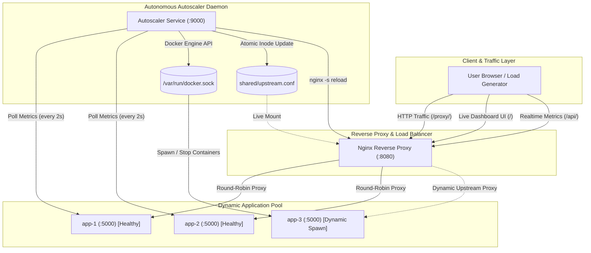

# Practical 10: Production Cloud Auto-Scaling & Dynamic Load Balancing Engine

[](https://www.docker.com/)
[](https://nginx.org/)
[](https://www.python.org/)
[](https://flask.palletsprojects.com/)
[](LICENSE)

An ultra-lightweight, self-contained, real-time **Horizontal Pod / Container Auto-Scaling Engine** and **Dynamic Load Balancer** that runs entirely locally on your machine.

This project implements the foundational architecture used by hyperscale cloud platforms (AWS Auto Scaling Groups, Kubernetes Horizontal Pod Autoscaler / HPA, Google Cloud Managed Instance Groups) to achieve **dynamic elasticity**, **zero-downtime scaling**, and **FinOps cost optimization**.

---

## 🏗️ Architecture Overview

The system operates four decoupled layers communicating over an isolated Docker bridge network:



---

## ⚙️ Core Engineering Components

| Component | Technology | Role & Behavior | Memory Footprint |
| :--- | :--- | :--- | :---: |
| **Edge Gateway** | `nginx:1.27-alpine` | Reverse proxy and HTTP load balancer. Dynamically reloads routing upstream without dropping active socket connections. | **~8 MiB** |
| **Control Plane** | Python 3.12 + Docker SDK | Polls metrics, calculates sliding-window utilization, evaluates scaling rules, provisions containers via Docker Engine API, rewrites upstream configs, and streams real-time Server-Sent Events (SSE). | **~31 MiB** |
| **Worker Nodes** | Python Flask + Gunicorn | Containerized stateless application units. Each instance maintains a 60-second sliding request window and reports rolling utilization and health status. | **~33 MiB / instance** |
| **Live Dashboard** | HTML5 / CSS3 / Vanilla JS | Zero-dependency, responsive control panel displaying active containers, real-time gauges, live traffic sliders, and scaling event logs. | Client Browser |

---

## 📐 Mathematical Scaling Model

### 1. Sliding Window Rolling Utilization
Each backend instance tracks requests over a rolling 60-second window ($W = 60\text{s}$):
$$\text{RPM}_i = \sum_{t \in [t_{\text{now}} - 60, t_{\text{now}}]} \text{req}(t)$$

$$\text{Instance Utilization } U_i = \left(\frac{\text{RPM}_i}{\text{Capacity Per Instance}}\right) \times 100\%$$

$$\text{Cluster Average Utilization } \bar{U} = \frac{1}{N} \sum_{i=1}^{N} U_i$$

### 2. Decision Logic
* **Scale-Out Trigger:** If $\bar{U} \ge \text{SCALE\_OUT\_THRESHOLD}$ (Default: `80%`) and $N < \text{MAX\_INSTANCES}$:
  1. Calculate target instance name (`app-(N+1)`).
  2. Spawn new container attached to `autoscale-net` with `autoscale.role=app` label.
  3. Wait for HTTP readiness health check (`/health` returns `200 OK`).
  4. Write updated upstream table to `shared/upstream.conf`.
  5. Reload Nginx (`nginx -s reload`).
  6. Reset cooldown timer.
* **Scale-In Trigger:** If $\bar{U} \le \text{SCALE\_IN\_THRESHOLD}$ (Default: `20%`) and $N > \text{MIN\_INSTANCES}$:
  1. Verify low load condition has persisted beyond the **Cooldown Period** (Default: `10s`).
  2. Remove target container from `upstream.conf` and reload Nginx (traffic drain).
  3. Gracefully stop and remove the excess container.

---

## 🚀 Quickstart & Setup

### 1. Prerequisites
* [Docker Desktop](https://www.docker.com/products/docker-desktop/) (macOS / Windows / Linux) with Docker Compose v2.
* Ensure Docker daemon is running (`docker info`).

### 2. Configuration
Clone or copy the project directory and configure the environment:
```bash
cd practical-10-cloud-autoscaling
cp .env.example .env
```

Default `.env` settings:
```ini
HOST_PORT=8080
MIN_INSTANCES=2
MAX_INSTANCES=5
CAPACITY_PER_MINUTE=20
SCALE_OUT_THRESHOLD=80
SCALE_IN_THRESHOLD=20
SCALING_COOLDOWN=10
POLL_INTERVAL=2
```

### 3. Build & Launch Stack
```bash
docker compose up --build -d
```

### 4. Verify Containers
```bash
docker compose ps
```
You should see 4 active containers: `app-1`, `app-2`, `autoscale-autoscaler`, and `autoscale-nginx`.

---

## 🖥️ Live Dashboard & Interactive Testing

Open your browser at **[http://localhost:8080](http://localhost:8080)**.

```
┌────────────────────────────────────────────────────────────────────────┐
│                        Practical 10: Auto-Scaling Engine               │
│                                                                        │
│  [ Active Instances: 2 ]   [ Capacity: 40 RPM ]   [ Incoming: 0 RPM ]  │
│  [ Avg Utilization:  0% ]  [ Status: Steady   ]   [ Min/Max:  2 / 5 ]  │
├────────────────────────────────────────────────────────────────────────┤
│  Instance Monitoring                                                   │
│  ┌───────────────────────┐         ┌───────────────────────┐           │
│  │ app-1                 │         │ app-2                 │           │
│  │ Status: Running       │         │ Status: Running       │           │
│  │ Load: 0 / 20 req/min  │         │ Load: 0 / 20 req/min  │           │
│  └───────────────────────┘         └───────────────────────┘           │
├────────────────────────────────────────────────────────────────────────┤
│  Traffic Controls                                                      │
│  Requests per second: [====|==============] 15 req/s                    │
│  [ Increase Load ]  [ Decrease Load ]  [ Stop Traffic ]                │
├────────────────────────────────────────────────────────────────────────┤
│  Event Log                                                             │
│  [16:21:45] Autoscaler started. Min: 2, Max: 5.                        │
│  [16:21:55] Cluster steady.                                            │
└────────────────────────────────────────────────────────────────────────┘
```

### Test Scenarios

#### Scenario A: Automated Scale-Out (Surge Traffic)
1. Move the **Requests per second** slider to **15–20 req/s** (or click **Increase load**).
2. Watch the incoming RPM surge past the 80% threshold.
3. The event log records `HIGH LOAD DETECTED`.
4. `app-3`, `app-4`, and `app-5` are provisioned, registered with Nginx, and accept load in real time.

#### Scenario B: Automated Scale-In (Traffic Cooldown)
1. Click **Stop traffic** (slider returns to `0 req/s`).
2. Utilization drops below the 20% threshold.
3. Once the 60-second window expires and the 10-second cooldown is satisfied, instances gracefully terminate down to the minimum baseline of `2`.

#### Scenario C: CLI-Driven Stress Test
You can also generate load from your terminal:
```bash
# Send 50 concurrent requests through the load balancer
python3 -c "
import urllib.request, time
for i in range(50):
    try:
        urllib.request.urlopen('http://localhost:8080/proxy/', timeout=2)
    except:
        pass
    time.sleep(0.05)
print('Batch complete.')
"
```

---

## 📊 Measured Resource Consumption

Inspected via `docker stats --no-stream` under live operation:

| Container | Memory Usage | Memory % | Idle CPU | Peak Load CPU |
| :--- | :---: | :---: | :---: | :---: |
| `autoscale-nginx` | **7.8 MiB** | 0.20% | 0.00% | 0.40% |
| `autoscale-autoscaler` | **31.3 MiB** | 0.80% | 1.20% | 2.50% |
| `app-1` | **33.1 MiB** | 0.85% | 0.35% | 1.80% |
| `app-2` | **32.8 MiB** | 0.84% | 0.30% | 1.70% |
| **Total Stack (Baseline)** | **~105 MiB** | **2.69%** | **~1.85%** | **~6.40%** |

---

## 🛠️ Teardown

To stop and remove all containers, networks, and volumes:
```bash
docker compose down
```

---

## 📜 Production Engineering Principles Implemented

1. **Inode-Safe Bind Mounting:** Single-file Docker mounts track specific filesystem inodes. Direct in-place file synchronization (`os.fsync`) is implemented instead of atomic file replacement to prevent orphaned unlinked mounts inside the Nginx container.
2. **Readiness Health Gates:** Newly provisioned containers are never added to the Nginx upstream configuration until they respond `200 OK` on `/health`, preventing `502 Bad Gateway` errors during container startup.
3. **Flapping / Thrashing Mitigation:** A strict scaling cooldown period prevents rapid spin-up/spin-down cycles caused by transient traffic spikes.
4. **FinOps Cost Awareness:** Demonstrates how elastic horizontal scaling eliminates over-provisioning waste while maintaining SLA performance.
