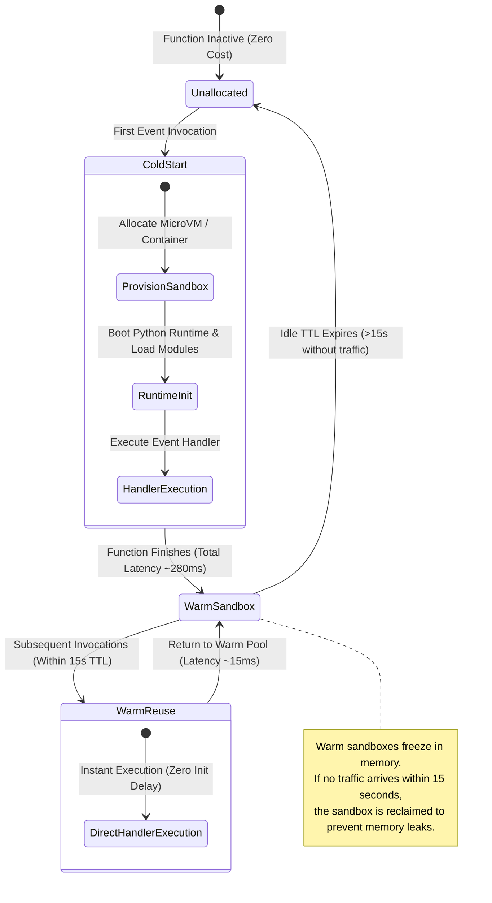

# Practical 12: Serverless Applications & FaaS Cold Start Engine

[](https://www.docker.com/)
[](https://nginx.org/)
[](https://www.python.org/)
[](LICENSE)

An ultra-lightweight (< 35 MB RAM) **Serverless Function-as-a-Service (FaaS) & Cold Start Simulation Engine** demonstrating event-driven container lifecycles, cold start initialization vs. warm sandbox reuse (~280 ms vs. ~15 ms), automatic concurrency scaling, and hyperscale GB-second micro-billing.

This project visualizes the core execution model behind AWS Lambda, Google Cloud Functions, and Azure Functions, demystifying the trade-offs of modern serverless cloud architectures.

---

## 🏗️ The Serverless Sandbox Lifecycle

In serverless architectures, developers deploy isolated code handlers rather than long-running server processes. Infrastructure is provisioned dynamically only when an invocation event arrives:



---

## 📐 Mathematical Execution & Billing Model

AWS Lambda and cloud FaaS providers bill compute based on **Memory Allocation** and **Billed Duration** rounded to the nearest millisecond:

### 1. Latency Breakdown
$$\text{Total Latency} = \text{Init Duration} + \text{Execution Duration}$$
* **Cold Start:** $\text{Init Duration} \approx 230\text{--}310\text{ ms} \implies \text{Total} \approx \mathbf{280\text{ ms}}$.
* **Warm Container Reuse:** $\text{Init Duration} = 0.0\text{ ms} \implies \text{Total} \approx \mathbf{15\text{ ms}} \quad (\approx \mathbf{20\times \text{ faster}})$.

### 2. Hyperscale Micro-Billing Formula
$$\text{GB-Seconds} = \left(\frac{\text{Allocated Memory (MB)}}{1024}\right) \times \left(\frac{\text{Billed Duration (ms)}}{1000}\right)$$

$$\text{Call Cost} = \frac{\$0.20}{10^6 \text{ requests}} + \left(\text{GB-Seconds} \times \$0.0000166667\right)$$

*Example (256 MB function running in 35 ms warm):*  
$$\text{Cost} = \$0.00000020 + (0.25 \times 0.035 \times 0.0000166667) \approx \mathbf{\$0.00000035}$$

---

## ⚙️ Component Breakdown

| Component | Technology | Role & Function | Resource Usage |
| :--- | :--- | :--- | :---: |
| **Reverse Proxy & Host** | `nginx:1.27-alpine` | Serves the interactive FaaS workbench and proxies invocation endpoints. | **~5.8 MiB** |
| **FaaS Control Plane & Sandboxes** | Python 3.12 + Flask + Gunicorn | Manages sandbox pools, simulates container cold starts, tracks idle TTL expiration, and computes GB-second billing. | **~24.5 MiB** |
| **Interactive Workbench** | Vanilla HTML5 / CSS3 / ES6 | Live function selector, single & burst invocation triggers, latency composition bars, and live sandbox pool inspector. | Client Browser |

---

## 🚀 Quickstart & Setup

### 1. Prerequisites
* [Docker Desktop](https://www.docker.com/products/docker-desktop/) (macOS / Windows / Linux) with Docker Compose v2.

### 2. Configure Environment
```bash
cd practical-12-serverless-lambda
cp .env.example .env
```

### 3. Launch Stack
```bash
docker compose up --build -d
```

### 4. Verify Active Containers
```bash
docker compose ps
```
You should see:
* `practical-12-faas-backend` (Up on port 5000)
* `practical-12-nginx` (Up on port 8080)

---

## 🖥️ Interactive Testing & Demonstration Protocol

Open your browser at **[http://localhost:8080](http://localhost:8080)**.

### Scenario A: Observe a Cold Start
1. Select the **Image Thumbnail Generator** (256 MB memory).
2. Click **⚡ Invoke Function**.
3. Notice the blue **`❄️ COLD START (~280 ms)`** badge:
   * **Init Duration:** ~260 ms (container boot + python runtime import).
   * **Execution Duration:** ~35 ms (actual handler code).
   * In the **Active Sandbox Container Pool**, a new warm sandbox appears with an **Idle TTL: 15.0s** countdown.

### Scenario B: Observe Warm Sandbox Reuse (Instant Speedup)
1. While the countdown timer is active, immediately click **⚡ Invoke Function** again.
2. The badge turns green: **`⚡ WARM CONTAINER REUSE (~15 ms)`**!
   * **Init Duration:** **`0.0 ms`**.
   * **Total Duration:** **`~18 ms`** ($> 90\%$ latency reduction).
   * The sandbox's reuse counter increments and its idle timer resets back to 15 seconds.

### Scenario C: Automatic Sandbox Eviction (Idle Reaping)
1. Stop invoking and watch the **Active Sandbox Container Pool**.
2. When the TTL timer hits `0.0s`, the background reaper reclaims the sandbox to simulate freeing memory.
3. If you invoke again, it triggers a fresh cold start.

### Scenario D: Automatic Concurrency Scaling (Burst Fan-Out)
1. Click **🚀 Invoke Burst (6x Concurrent Fan-Out)**.
2. The engine dispatches 6 parallel requests simultaneously.
3. Because existing single sandboxes cannot execute concurrent calls without queueing, the FaaS engine dynamically provisions **6 independent sandboxes in parallel**, showcasing automatic cloud horizontal elasticity.

---

## 🧪 CLI-Driven Validation

You can invoke functions directly via the command line:

```bash
# 1. Trigger initial invocation (Expect Cold Start)
curl -s -X POST http://localhost:8080/api/invoke \
  -H "Content-Type: application/json" \
  -d '{"function_id": "image-thumbnailer"}' | python3 -m json.tool

# 2. Immediately trigger second invocation (Expect Warm Reuse, 0ms init)
curl -s -X POST http://localhost:8080/api/invoke \
  -H "Content-Type: application/json" \
  -d '{"function_id": "image-thumbnailer"}' | python3 -m json.tool

# 3. Trigger 6x concurrent burst
curl -s -X POST http://localhost:8080/api/invoke-burst \
  -H "Content-Type: application/json" \
  -d '{"function_id": "sentiment-analyzer", "count": 6}' | python3 -m json.tool
```

---

## 📊 Measured Resource Consumption

Inspected via `docker stats --no-stream` under live operation:

| Container | Memory Usage | Memory % | CPU % |
| :--- | :---: | :---: | :---: |
| `practical-12-nginx` | **5.8 MiB** | 0.15% | 0.00% |
| `practical-12-faas-backend` | **24.5 MiB** | 0.64% | 0.08% |
| **Total Stack** | **~30.3 MiB** | **0.79%** | **~0.08%** |

---

## 🛠️ Teardown

To stop the containers and free resources:
```bash
docker compose down
```
