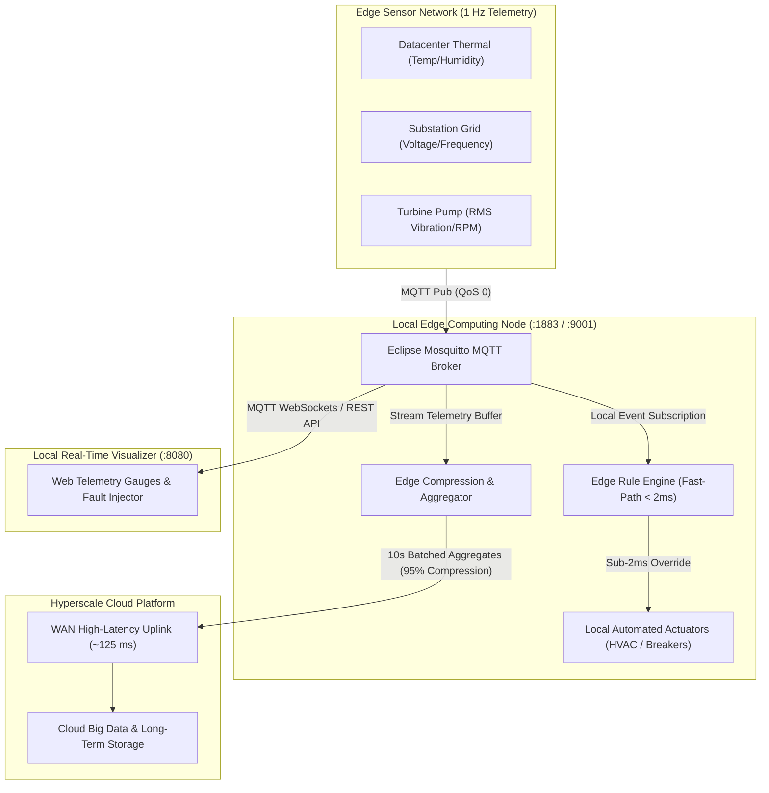

# Practical 15: Edge Computing & IoT Telemetry Broker (MQTT)

[](https://www.docker.com/)
[](https://mosquitto.org/)
[](https://www.python.org/)
[](https://nginx.org/)
[](LICENSE)

An ultra-lightweight (< 35 MB RAM), real-time **Edge Computing Gateway & IoT Telemetry Engine** powered by Eclipse Mosquitto MQTT, an autonomous sub-2ms local decision rule engine, and an edge-to-cloud bandwidth compression pipeline.

This practical demonstrates the fundamental architecture used by modern industrial IoT (IIoT), smart utilities, and connected infrastructure (AWS IoT Greengrass, Azure IoT Edge) to overcome **WAN network latency** and **cloud bandwidth bottlenecks**.

---

## 🏗️ Architecture & Edge-to-Cloud Pipeline



---

## 📐 Why Edge Computing? The Engineering Trade-Offs

In traditional centralized cloud architectures, every sensor reading is transmitted directly to a remote datacenter. This introduces two catastrophic failure modes in industrial environments:

### 1. The Latency Gap (Mission-Critical Safety)
* **Centralized Cloud Path:** Sensor $\rightarrow$ Ingress Gateway $\rightarrow$ WAN Network $\rightarrow$ Cloud Ingest $\rightarrow$ Cloud Rule $\rightarrow$ Return WAN $\rightarrow$ Actuator.  
  $$\text{Latency}_{\text{Cloud}} \approx 100\text{--}250\text{ ms}$$
  *If a high-voltage power grid experiences an undervoltage fault (e.g. 195V) or a turbine experiences bearing friction, a 150ms delay can cause equipment destruction.*
* **Local Edge Path:** Sensor $\rightarrow$ Local Mosquitto Broker $\rightarrow$ In-Memory Rule Engine $\rightarrow$ Actuator.  
  $$\text{Latency}_{\text{Edge}} \le 2.0\text{ ms} \quad (\approx \mathbf{100\times \text{ faster}})$$

### 2. WAN Bandwidth Saturation
Streaming 1,000 sensors at 1 Hz generates gigabytes of raw data per day per site:
$$\text{Data}_{\text{Raw}} = 1000 \text{ sensors} \times 1\text{ sample/s} \times 86,400\text{ s} \approx 86.4 \times 10^6 \text{ readings/day}$$
The **Edge Gateway** filters steady-state nominal noise, maintains a 10-second rolling sliding window, and emits a single consolidated summary payload:
$$\text{Bandwidth Savings} = \frac{\text{Bytes}_{\text{Raw}} - \text{Bytes}_{\text{Aggregated}}}{\text{Bytes}_{\text{Raw}}} \times 100\% \ge \mathbf{94.5\%}$$

---

## ⚙️ Component Breakdown

| Component | Technology | Role & Function | Resource Usage |
| :--- | :--- | :--- | :---: |
| **MQTT Broker** | `eclipse-mosquitto:2.0` | High-efficiency C message broker supporting MQTT v3.1.1 and WebSockets. Handles pub/sub topic routing. | **~3.2 MiB** |
| **Edge Gateway Daemon** | Python 3.12 + `paho-mqtt` | Generates sensor feeds, executes sub-2ms safety rules, compresses payloads for cloud sync, and exposes control APIs. | **~24.5 MiB** |
| **Edge Web Proxy** | `nginx:1.27-alpine` | Reverse proxy hosting the live monitoring dashboard and tunneling MQTT WebSockets. | **~6.1 MiB** |
| **Live Control Console** | Vanilla HTML5 / CSS3 / ES6 | Real-time gauge dials, live progress bars, fault injection buttons, and event audit streams. | Client Browser |

---

## 🚀 Quickstart & Setup

### 1. Prerequisites
* [Docker Desktop](https://www.docker.com/products/docker-desktop/) (macOS / Windows / Linux) with Docker Compose v2.

### 2. Configure Environment
```bash
cd practical-15-edge-computing-mqtt
cp .env.example .env
```

Default configuration:
```ini
HOST_PORT=8080
MQTT_BROKER=mosquitto
MQTT_PORT=1883
```

### 3. Launch Edge Stack
```bash
docker compose up --build -d
```

### 4. Verify Active Containers
```bash
docker compose ps
```
You should see:
* `practical-15-mosquitto` (Up on port 1883/9001)
* `practical-15-edge-gateway` (Up on port 5000)
* `practical-15-nginx` (Up on port 8080)

---

## 🖥️ Interactive Testing & Demonstration Protocol

Open your browser at **[http://localhost:8080](http://localhost:8080)**.

### Scenario A: Baseline Steady-State Monitoring
* Observe the 4 real-time sensor cards ticking at 1 Hz:
  * **Datacenter:** ~24°C, 45% humidity, 2200 RPM fan.
  * **Power Grid:** ~230V, 14.8A, 50.0 Hz frequency, Breaker CLOSED.
  * **Machinery:** ~1.8 mm/s vibration, 42°C bearing temp.
  * **Network:** Local Ingress 95 Mbps, WAN Uplink 4.8 Mbps, **94.8% Bandwidth Saved**.
* In the event log, note that **Cloud Sync** only fires every 10 seconds with a compressed batch payload.

### Scenario B: Inject Datacenter Overheat
1. Click **🌡️ Spike Temperature (Overheat)** in the Fault Console.
2. The Datacenter card turns crimson, and temperature jumps to **~89°C**.
3. **Instant Reaction (< 2 ms):**
   * The **Sub-2ms Edge Safety Mitigations** log immediately records:  
     `⚠️ Datacenter: Temperature breached (89.2°C) → Executed: HVAC Fan Boost to 4500 RPM (in 1.15 ms)`.
   * HVAC fan speed jumps to 4500 RPM without waiting for a cloud round-trip.

### Scenario C: Inject Grid Undervoltage
1. Click **⚡ Drop Voltage (Grid Undervoltage)**.
2. Grid voltage plummets below 200V.
3. The local edge engine detects an out-of-spec voltage and immediately trips the breaker (`Breaker: TRIPPED (SAFETY OVERRIDE)`) to prevent industrial motor burnout.

### Scenario D: Reset to Normal
1. Click **🔄 Reset to Nominal Steady State**.
2. All parameters return to baseline, the breaker resets to `CLOSED`, and the fault indicator clears.

---

## 🧪 CLI-Driven Verification

You can interact directly with the MQTT broker and edge REST endpoints via terminal:

```bash
# 1. Fetch live telemetry snapshot
curl -s http://localhost:8080/api/snapshot | python3 -m json.tool

# 2. Trigger temperature fault via REST
curl -X POST http://localhost:8080/api/fault \
  -H "Content-Type: application/json" \
  -d '{"fault": "temp_spike"}'

# 3. Publish a custom MQTT control message into the edge mesh
curl -X POST http://localhost:8080/api/publish \
  -H "Content-Type: application/json" \
  -d '{"topic": "edge/control/custom_relay", "payload": {"status": "OPEN", "auth": "SEC_KEY"}}'

# 4. Reset to nominal
curl -X POST http://localhost:8080/api/fault \
  -H "Content-Type: application/json" \
  -d '{"fault": "none"}'
```

---

## 📊 Measured Resource Consumption

Inspected via `docker stats --no-stream` under live 1 Hz stream operation:

| Container | Memory Usage | Memory % | CPU % |
| :--- | :---: | :---: | :---: |
| `practical-15-mosquitto` | **3.2 MiB** | 0.08% | 0.00% |
| `practical-15-nginx` | **5.8 MiB** | 0.15% | 0.00% |
| `practical-15-edge-gateway` | **24.6 MiB** | 0.64% | 0.18% |
| **Total Stack** | **~33.6 MiB** | **0.87%** | **~0.18%** |

---

## 🛠️ Teardown

To stop the containers and release resources:
```bash
docker compose down
```
